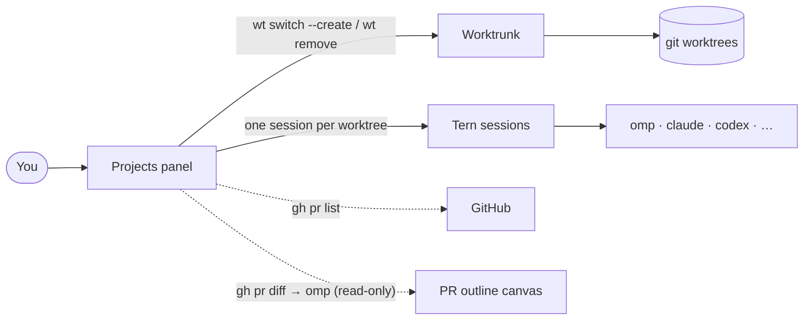

<div align="center">

<h1></h1>

**Mission control for parallel agent work.**

One panel for every branch you have in flight: its worktree, its agents and its pull request.<br>
Click a row and you're in that branch's own workspace.


</div>

---

Running five agents on five branches means five checkouts, a pile of terminals, and losing track of which agent is stuck waiting for you. Overseer is a [Tern](https://docs.stencil.so/tern/) plugin that fixes that:

- **Every worktree gets its own Tern session.** Its tabs, shells and agents live there. Switching branches is one click, and nothing bleeds between them.
- **You can see what every agent is doing.** A pulsing dot means an agent is working; a blue dot means one is waiting for you.
- **PRs sit on the row.** GitHub PR state (draft, open, merged, closed), one click away.
- **Worktrees come and go safely.** Creation and deletion run through [Worktrunk](https://worktrunk.dev) in the background, with your hooks and approvals intact.
- **PRs can be understood at a glance.** **Visualize PR** turns a pull request into a diagram-first outline, without touching GitHub.

## The panel

The panel stays with you: it sits on the left of whichever tab you're looking at, across every session, and keeps the width you give it. Each project is a local Git repository. Under it, every worktree is a row, and under each row are its open tabs. Click a tab to jump straight to it. Hover a row for its branch, path, line counts, ahead/behind and PR.

<table>
<tr>
<td width="50%"></td>
<td width="50%">

| You see | It means |
|---|---|
| ● green | A session is open |
| ● green, pulsing | An agent is working |
| ● blue, haloed | An agent is waiting for your answer |
| ○ hollow | No session yet; click to open one |
| **✱** amber | Uncommitted changes |
| **conflicts** | A merge or rebase is stuck |
| PR icon | Draft, open, merged or closed PR |
| 🧊 | Parked in the Ice Box |

</td>
</tr>
</table>

## Install

You need macOS and:

| | Required for | |
|---|---|---|
| [Tern](https://docs.stencil.so/tern/) desktop 0.9.6 or later | everything | tested with 0.9.6 |
| [Worktrunk](https://worktrunk.dev) (`wt`), Git, Bash | everything | tested with wt 0.40.0 |
| [GitHub CLI](https://cli.github.com) (`gh`), signed in | PR badges, Visualize PR | optional |
| [omp](https://omp.sh) | Visualize PR | optional |

```sh
git clone https://github.com/mmnavarr/overseer.git
cd overseer
/Applications/Tern.app/Contents/MacOS/tern plugin link "$PWD"
```

Linking reloads the plugin whenever the source changes. Use `tern plugin install "$PWD"` instead if you'd rather have a frozen copy.

## Use it

1. **Show Projects:** <kbd>⌘</kbd><kbd>⌥</kbd><kbd>⇧</kbd><kbd>P</kbd>, or **Show or hide Projects** in the command palette. Press it again while the panel has focus to hide it.
2. **Add a repo:** **+** in the header opens the folder picker.
3. **Open a worktree:** click its row. Its session opens, and the panel comes with it.
4. **New worktree:** **+** next to a project. Type a branch name (and, if you like, a friendly display name). Setup runs in a background **Create** tab, and a notification tells you when it's ready.
5. **Everything else is a right-click away:**


- **Visualize PR** for a reviewer's outline of the branch's pull request
- **Rename** changes the row's label (the branch stays as it is)
- **Add to Ice Box** parks a worktree at the bottom; 🧊 in the header hides or shows parked ones
- **Close session** stops its programs and closes its tabs (the files stay)
- **Delete worktree** runs `wt remove`. It refuses if there are uncommitted changes and always keeps the branch.
- On a project: **Change base branch** and **Remove project**. Removing only takes the project off the list: the repository, its worktrees and open sessions stay, and Overseer forgets the project's display names, Ice Box entries and session links. Add it again with **Add project**.

### Visualize a PR


Overseer fetches the PR's metadata and full diff from GitHub, then has omp write an outline following HumanLayer's [visual-pr](https://github.com/humanlayer/skills) skill: why the change exists, what to watch for, and Mermaid diagrams, file-tree diffs and pseudocode. The local checkout only adds surrounding context. It takes a minute or two, and unchanged PRs reopen instantly from a cache.

It's **read-only by construction**: omp runs with only read/grep/glob tools and no shell, so it can't push, comment or edit anything.

## How it works



- **Worktrunk owns the worktrees.** Overseer calls `wt` and never passes `--yes`, `--no-hooks` or force flags. Your hooks and approval prompts run in a visible tab.
- **Tern owns the sessions.** Overseer remembers which session belongs to which worktree and switches between them.
- **The panel follows you.** Tern plugins can't pin a sidebar to the window, so Overseer keeps one Projects panel per window and moves it into whichever tab you're on.
- **Everything else is a read.** PR badges, agent status and change counts come from `gh`, `git` and Tern's own agent state.

## Safety

- Creation never fetches, pulls, or checks out anything in your primary checkout.
- Deletion rechecks the repository, branch and cleanliness right before it runs. It never deletes a branch. The primary checkout can't be deleted.
- Ignored files are removed with a deleted worktree's directory, so copy out anything you need first.
- Branch names and paths are passed as arguments, never as shell text.

---

## For agents

This section is for coding agents (and humans) changing Overseer. It favors completeness over brevity.

### Runtime model

Overseer is a Tern plugin written in Luau. `plugin.toml` declares two entry points:

- `host.luau` runs in Tern's host and renders the `overseer.form` block, the native form used for New worktree, Rename and Change base branch. `input.luau` is its Unicode-aware text editing.
- `window.luau` runs once per Tern window. It owns the Projects panel (a canvas that follows you between tabs), event hooks, the background job tracker and Visualize PR canvases.

Tern APIs are typed in the definitions Tern generates: `/Applications/Tern.app/Contents/MacOS/tern plugin types <dir>` writes `tern.d.luau`. Read it before using an API you haven't used here.

### The 50 ms rule (read this first)

Tern gives **every plugin callback 50 ms of its own Lua** (4 ms in the status formatter), and at most ten times that in total wall time, Tern's own calls included (`cx`, `tern.fs`, `tern.kv`, starting a process). An overrun **pauses that hook** (`canvas_action`, `timer`, `process`, …): 5 s, doubling for each repeat within 10 minutes, up to 5 minutes. Timer, process and fetch callbacks that come due meanwhile wait. Tern toasts the overrun; Overseer's `budget` handler logs each pause and resume to `~/Library/Logs/Tern/tern.log`. A paused `canvas_action` makes clicks in the panel answer `Nothing handles "open" here` until it resumes.

Consequences, enforced throughout `window.luau`:

- **Never draw inline from clicks, events or process results.** Call `redraw(cx)`. It queues one coalesced `draw` in its own `tern.timer(0)` callback.
- There is **one panel per window**, so a draw costs the same however many sessions are open. (When every session had its own panel, one click cost 40 ms with eight sessions.)
- Split expensive sequences across callbacks. `openForm` opens the panel first and swaps the form in on the next tick. `separately(fn)` runs `fn` in its own callback with errors reported.
- Process results (`tern.process.run` callbacks) must stay small too. They update state and call `redraw`.

When debugging an overrun, add temporary `tern.log.warn(string.format("PROBE …=%.1f", tern.now() - t0))` timings, reproduce in an isolated window (below), and remove them afterwards.

### Files

| File | What lives there |
|---|---|
| `window.luau` | Project registry, model building (`model`), drawing (`draw`/`redraw`), the following panel (`slot`, `pin`, `follow`, `togglePanel`), session binding (`ensureSession`, `openWorktree`), forms swapped into the panel's slot, background jobs (`launchCreation`, `checkJobs`), Visualize PR canvases, hooks and the 750 ms `tick`. |
| `worktrunk.luau` | Every external command: `wt list`, validation, the creation and removal command lines, `git` status, `gh pr list`/`gh pr view`/`gh pr diff`. Commands are argv arrays; `find_executable` checks Homebrew, `/usr/local/bin`, `~/.bun/bin` and `~/.local/bin`. |
| `visualize.luau` | Visualize PR: prompt, read-only omp invocation, output extraction, cache. |
| `view.luau` | Pure render: model → Tern UI node tree (rows, badges, tab rows, confirmations, menus). |
| `worktree-operation.sh` | The helper that runs `wt switch --create` / `wt remove` in a visible terminal and writes an atomic completion receipt. |
| `host.luau`, `input.luau` | The native form block and its text input. |
| `styles.css`, `icons.css` | Panel styles. `icons.css` is **generated** by `icons/generate-css.py` (plugin stylesheets can't load files, so icons are embedded as data URIs). |
| `skills/visual-pr/` | HumanLayer's visual-pr skill, vendored unchanged (MIT). |
| `tests/test_worktree_operation.py` | Real Git/Worktrunk tests for the helper. |

### State

Tern's plugin KV (`~/Library/Application Support/Tern/plugin-data/overseer/kv.json`), via `tern.kv`:

| Key | Shape | Notes |
|---|---|---|
| `projects` | `[{id, name, path, base}]` | `id` is the repository's shared Git directory, so linked checkouts dedupe. Entries saved by older versions may also carry an unused `linear`. |
| `worktree-names` | `{[projectId]: {[path]: name}}` | Display names. Removed when Overseer deletes the worktree. |
| `sessions` | `{[path]: {id, host, project}}` | Worktree → Tern session binding. |
| `icebox` | `{[projectId]: {[path]: true}}` | Parked worktrees. `show-icebox` is the header toggle. |
| `jobs` | `{[id]: {kind = "create" \| "remove", project, receipt, pane, …}}` | Running creations and deletions; creations also carry `branch`, `displayName?` and `agentPrompt?`. Persisted so a plugin reload doesn't lose them. |
| `panel-open`, `panel-share` | `boolean`, `number` | Whether you want the Projects panel shown (the shortcut sets it), and its width as a share of the tab. |
| `pending-form:<pane>`, `form:<token>` | `{token, mode, project?, path?, response?}`, the form's answer | An open form's request, and the answer its block writes on Submit or Back. Removed when the form finishes, or when the window closes its pane. |

Files under `tern.plugin.data`: `creation-<id>.status` and `removal-<id>.status` receipts written by the helper, and the `visual-pr/<project>-<pr>-<headsha>.md` outline cache.

In-memory only: the per-project `cache` (worktrees, PRs, loading/error flags), `rendered` signatures per panel pane, the panel's pane and last tab, open outline canvases.

### Flows

**Refresh.** `refresh` runs `wt list --format=json` per project, then `refreshPullRequests` (one `gh pr list` per GitHub project, at most every 2 minutes, immediately after ↻ or a worktree set change). An open panel refreshes every 15 s from `tick`.

**The following panel.** Tern panes belong to one tab, and plugins can't add a window-level sidebar, so the window keeps exactly one Projects slot and moves it into whichever tab is shown, left of everything and full height. `slot` finds it: the navigator canvas or a form shown in its place, adopting what a reload left open and closing any extra. `pin` moves it with `move_to_tab` (or `unpark`) then `move(…, "left")` and steers the split ratio to the remembered share, since Tern resizes in cells and hidden tabs measure differently. `follow` runs on `focus`, `tab_created`, `tab_closed`, `pane_created`, `pane_closed` (each through `followSoon`, one coalesced timer callback), `window_start` and every `tick`, so one paused hook can't strand the panel. Moves work across sessions. Edge cases:

- **Last terminal in a tab closed:** the panel would be left alone, so `follow` parks it; the tab closes as Tern would have, and the next shown tab (or new tab) takes the panel back.
- **Overseer closes a session:** `closeManagedSession` switches away and calls `follow` first, so the panel leaves before the session closes.
- **Tern closes the panel's tab or session:** the panel dies with it. If you wanted it (`panel-open`) and its last tab is gone, `follow` opens a fresh one in the shown tab. If its tab is still there, you closed the panel yourself, and it stays closed until the shortcut.

**Create.** Form → `wt.validate` → `launchCreation` opens a background tab running `worktree-operation.sh` and records a job → `checkJobs` (on `tick`) reads the receipt → on success: toast, then apply the display name by branch (`applyCreatedName`). Creation succeeded means `wt` exited 0, not that every hook succeeded.

**Delete.** Confirmation → `wt.validate_removal` (repository identity, branch, cleanliness) → removal job in a background tab → receipt → close the worktree's session only if the directory is gone, then drop its name, binding and Ice Box entry.

**Agent status.** Native agent blocks: `agentStates` maps pane id → `"working"` or `"waiting"`. Tern's `agent_state` event (`{pane, old, new}`) keeps it current and triggers a redraw; `seedAgents` fills it once per load from `cx.agents:list()`, since events only report changes, and `pane_closed` drops the pane. `agentActivity` reads that table and makes no Tern calls of its own. For agent CLIs in plain terminals (`omp`, `pi`, `claude`, `codex`, `opencode`, `gemini`, `aider`, `amp`, `cursor-agent`, `crush`, `goose`) it uses the pane's `busy` flag. Waiting wins over working per session and tab. Don't poll `cx.agents:list()`: it reads every block's last message (10–45 ms cold).

**Visualize PR.** `wt.pull_request_meta` (`gh pr view --json …`) and `wt.pull_request_diff` (`gh pr diff > file`) write the PR into a temp dir under plugin data. Then `omp -p --no-session --no-extensions --no-skills --no-title --tools=read,grep,glob "<prompt>"` runs in the worktree with a 10-minute timeout. Its stdout from the first Markdown heading becomes the canvas. The read-only guarantee is the tool allow-list. Keep it that way: never add shell, edit or write tools, and never let it call `gh`.

### Developing

Run the helper's tests (they use temporary repos, config and approvals):

```sh
python3 -B tests/test_worktree_operation.py -v
bash -n worktree-operation.sh
```

Smoke-test UI changes in an **isolated Tern window** so your real sessions are untouched:

```sh
D=$(mktemp -d); mkdir -p "$D/config"
TERN_CONFIG_DIR="$D/config" tern plugin link "$PWD"
TERN_CONFIG_DIR="$D/config" TERN_DAEMON_SOCKET="$D/daemon.sock" \
  /Applications/Tern.app/Contents/MacOS/tern --control "$D/desktop.sock"
```

Drive it with `tern ctl --control "$D/desktop.sock" …`:

- `ready`, `palette Projects`, `key Enter`, `click X Y [right]`, `shot NAME` (screenshots land in `target/shots/tern/live/`)
- `tree "[data-role=overseer\.worktreeRow]"` returns node rects and text
- `a11y` returns menu items and their bounds
- `carly lua "…"` runs Lua with a window `cx`, and `state` shows the result under `.carly.last_tool`

Seed projects by writing `$D/config/plugin-data/overseer/kv.json` before launch.

Other conventions:

- Editing any file in a linked plugin reloads it in every running Tern. `tern plugin reload overseer` reloads only Overseer.
- After changing an icon, run `python3 icons/generate-css.py`.
- Bump `version` in `plugin.toml` for user-visible changes and add an entry to [`CHANGELOG.md`](CHANGELOG.md). A change to how the panel or its state is structured is a major version.
- Keep external commands in `worktrunk.luau` as argv arrays. Shell is only used where a redirect is needed, with arguments as `$0…$n`.

### Known limitations

- macOS only (folder picker, paths, Tern desktop).
- Visualize PR fails on PRs whose diff exceeds GitHub's 20,000-line API limit (`gh pr diff` returns HTTP 406). The tab shows the error.
- The panel moves into each tab you switch to, so every switch animates briefly and resizes the terminals in both tabs (full-screen programs redraw). Tern can only move a pane beside another pane, so in a tab with more than one pane Overseer rearranges the others back into the same splits and ratios to the panel's right; their ratios can drift by up to half a percent.
- A plugin reload during a Visualize PR run, including the one Tern does when you edit a file in a linked plugin, ends the run and leaves its tab on the waiting message. Run it again.
- Multiple Tern windows work but haven't been exhaustively tested together.

---

## Credits

- Pull request and info icons: [Primer Octicons](https://primer.style/octicons/) (MIT, `icons/LICENSE`).
- Visualize PR follows [humanlayer/skills](https://github.com/humanlayer/skills)' visual-pr skill, vendored at `ca7c8088db69` (MIT, `skills/visual-pr/LICENSE`).
- Built on [Tern](https://docs.stencil.so/tern/), [Worktrunk](https://worktrunk.dev) and [omp](https://omp.sh).

## Changelog

See [CHANGELOG.md](CHANGELOG.md). 2.0 replaced the panel-per-session layout with one panel that follows you between tabs.

## License

[MIT](LICENSE)
