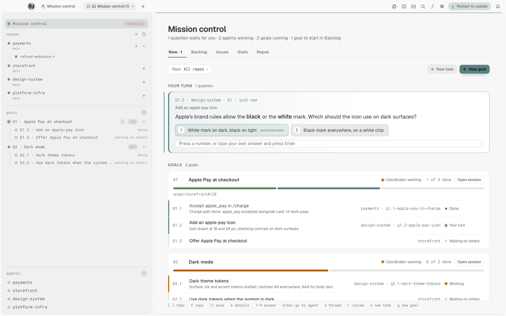
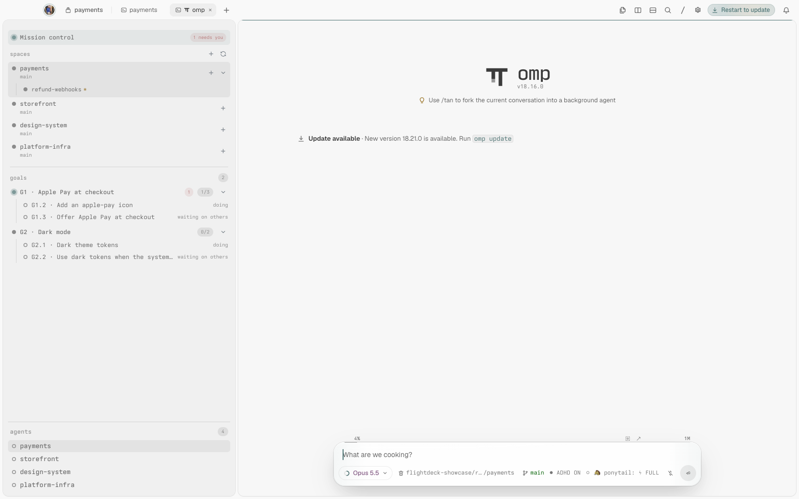
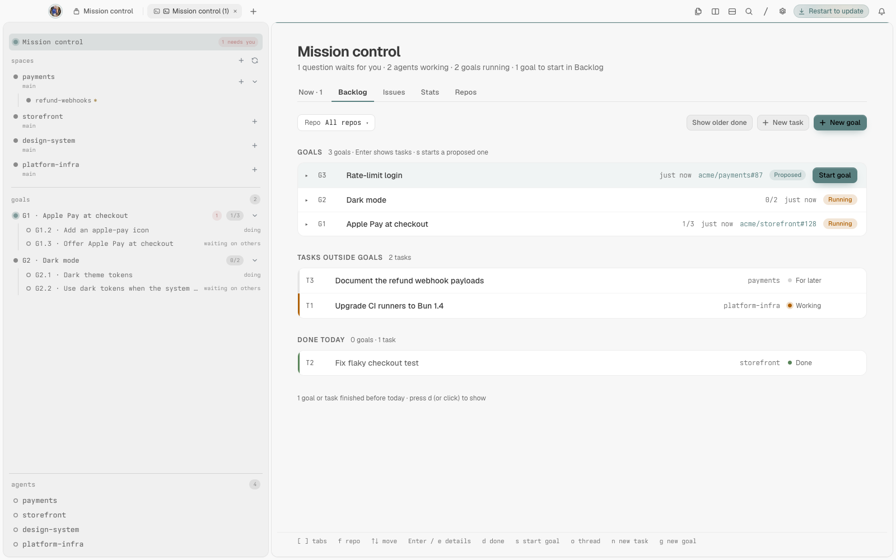
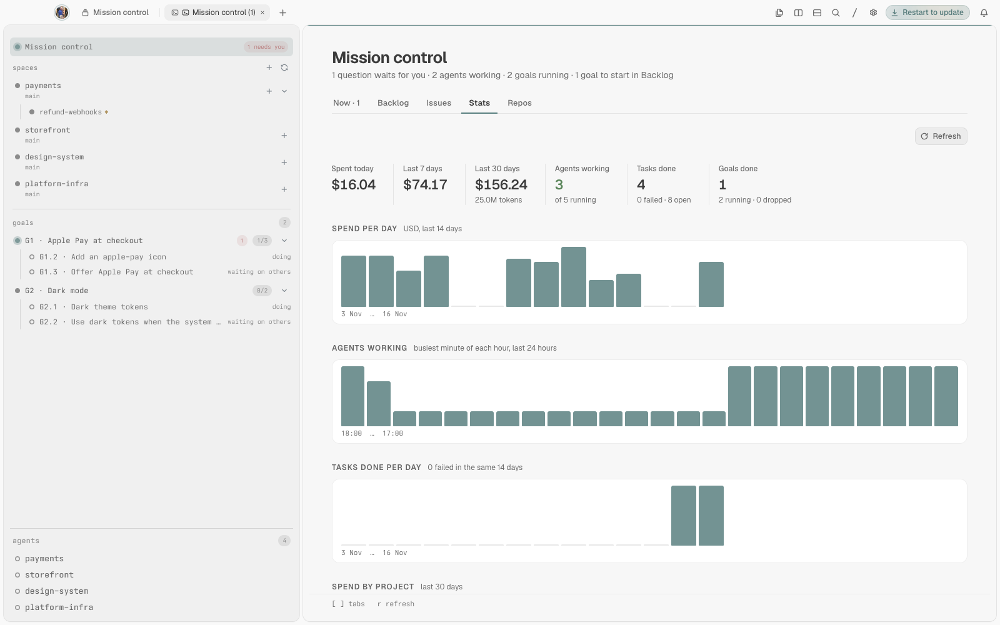
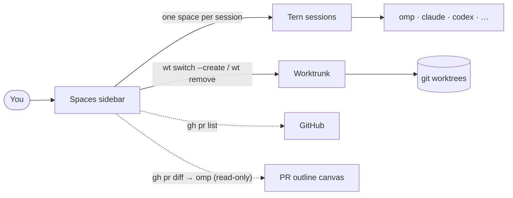

# Flightdeck

> **Flightdeck is a fork of [Overseer](https://github.com/mmnavarr/overseer) by Malcolm Navarro**, and heavily inspired by it. The sidebar, worktree handling and Visualize PR started as Overseer's; Flightdeck adds Mission control for coordinating agents. Thanks, Malcolm.

Flightdeck is a [Tern](https://docs.stencil.so/tern/) plugin for running many [omp](https://omp.sh) coding agents at once, across many repositories, without losing track of them.

It does two jobs:

1. **A sidebar that keeps you oriented.** Every Tern session is a *space*, named after its folder. Git worktrees nest under their repository, each with its own session. Every running agent is listed with a dot for its state (working, waiting for you, idle) and the task it's on. Click anything to go there.
2. **Mission control, a place to run and steer agents' work.** A tab that shows every question agents are waiting on you for, every task in progress, and *goals*: outcomes you (or an agent) describe, which a *coordinator* agent breaks into tasks and hands to *worker* agents, each in its own Git worktree, until the goal is done. It also lists your repositories' GitHub issues (turn one into a goal in a click) and what your agents spend.

Everything runs on your Mac: a small local server (Bun, SQLite) behind a random token, talking to Tern and to omp. Nothing is sent anywhere except the GitHub calls you'd make with `gh`.

<picture>
  <source media="(prefers-color-scheme: dark)" srcset="docs/images/mission-now-dark.png">
  
</picture>

## What you can do

**In the sidebar**

- Open folders as spaces (**+**), switch between spaces, worktrees and agents with a click or <kbd>⌃</kbd><kbd>⌘</kbd><kbd>[</kbd> / <kbd>]</kbd>.
- Create and delete worktrees through [Worktrunk](https://worktrunk.dev) (your hooks and approvals run in a visible tab), see their PRs, uncommitted changes and conflicts at a glance.
- Right-click a worktree for **Visualize PR**: a read-only, diagram-first outline of its pull request.
- See each running goal, its progress and its tasks, under **Goals**.

<picture>
  <source media="(prefers-color-scheme: dark)" srcset="docs/images/sidebar-dark.png">
  
</picture>

**In Mission control** (the button at the top of the sidebar, or <kbd>⌘</kbd><kbd>⌥</kbd><kbd>⇧</kbd><kbd>M</kbd>)

| Tab | What it's for |
|---|---|
| **Now** | What's happening: questions waiting for you (answer with a click, a number key, or your own words), running goals with a progress rail per task, and work in progress outside goals. Click any item for its details, its agent, its thread or its changes. |
| **Backlog** | Every goal and task: proposed goals to start, what finished today, and (on request) older work. **New goal** and **New task** open a short form. |
| **Issues** | Open GitHub issues across your repositories. Make one (or several) into a goal, link one to a goal, open it, or close it as not planned. |
| **Stats** | Spend per day, project, model and goal (read from omp's own usage records), agents working per hour, tasks finished per day. Hover a bar for details. |
| **Repos** | Every Git repository Flightdeck found on your Mac. Click one for its worktrees (branch, ahead/behind, uncommitted changes, conflicts, last commit), each with **Open**; open the repository as a space, hide it from agents, hide just its issues, or open it on GitHub. |

<table><tr><td>

<picture>
  <source media="(prefers-color-scheme: dark)" srcset="docs/images/mission-backlog-dark.png">
  
</picture>

</td><td>

<picture>
  <source media="(prefers-color-scheme: dark)" srcset="docs/images/mission-stats-dark.png">
  
</picture>

</td></tr></table>

**How a goal runs**

1. You (or an agent, with `goal_propose`) write what should be true when it's done. Tasks are optional.
2. **Start goal** opens a background session with a *coordinator* agent. It reads the repositories, plans tasks (`goal_plan`), and starts *workers* (`worker_start`), each in a fresh worktree on its own branch.
3. Workers report progress, ask you questions (they appear under **Now**; answer from there or in the agent's pane), and finish their task. The coordinator reads each result, closes the worker (`worker_stop`), and once the work is merged or no longer wanted removes its worktree and branch (`worktree_remove`; the result comes back to it). It starts follow-ups and asks you when it needs a decision.
4. When the coordinator is satisfied nothing is left (every task finished, workers closed, worktrees removed or kept for a stated reason, no question waiting for you), it finishes the goal itself with `goal_complete` and a summary: what was done, each PR and its state, anything left for you. Flightdeck refuses `goal_complete` until those checks pass, and needing your direction doesn't count as done. The goal's session closes once its agents are idle. You can still close a goal yourself (**Close goal**), which lists its remaining worktrees and their PRs and removes the merged ones.

References: goals are `G3`, a goal's tasks `G3.1`, `G3.2` (its coordinator is `G3.0`), tasks outside goals `T7`. Linked GitHub issues get a comment when the goal starts and finishes; PRs close them with `Fixes owner/repo#12`, never Flightdeck itself.

**Also**

- **Unlock SSH key** (palette): if your SSH key is on a hardware security key, this floats a terminal running `git fetch` so the key asks for its touch or PIN. Agents are told to ask you for this rather than work around a locked key. Bind it to a key in Tern's `settings.json`, for example `"keybinds": { "cmd+shift+s": "plugin.flightdeck.unlock-key" }`.

## Install

You need macOS and:

| | Needed for | |
|---|---|---|
| [Tern](https://docs.stencil.so/tern/) desktop 0.9.24 or later | everything | uses 0.9.24's spawn, streamed fetch and block status |
| [Worktrunk](https://worktrunk.dev) (`wt`), Git | worktrees, goal workers | tested with wt 0.80 |
| [omp](https://omp.sh) | agents, Mission control, Visualize PR | tested with 18.21 |
| [Bun](https://bun.sh) | Mission control's server | |
| [GitHub CLI](https://cli.github.com) (`gh`), signed in | PR badges, Issues, Visualize PR | optional |

1. Install it into Tern: in Tern's plugin settings, add `https://github.com/itsjxck/flightdeck`. Or from a terminal:
   ```sh
   /Applications/Tern.app/Contents/MacOS/tern plugin install github.com/itsjxck/flightdeck
   ```
   To update later, run the same command with `--force`. (Working on Flightdeck itself? Clone it and run `tern plugin link <folder>` instead: Tern then reloads it whenever a file changes.)
2. In Tern's command palette, run **Connect omp to Flightdeck**. It adds a `flightdeck` MCP server to `~/.omp/agent/mcp.json` and a short work-tracking note to `~/.omp/agent/AGENTS.md` (between `<!-- flightdeck -->` markers; rerunning replaces it). Flightdeck reminds you once per launch until it's done.
3. Open the sidebar with <kbd>⌘</kbd><kbd>⌥</kbd><kbd>⇧</kbd><kbd>P</kbd>, and Mission control with <kbd>⌘</kbd><kbd>⌥</kbd><kbd>⇧</kbd><kbd>M</kbd>. Agents you start from now on have the tools.

Optional: `repos.json` in the plugin data folder (`~/Library/Application Support/Tern/plugin-data/flightdeck/`) sets where Flightdeck looks for repositories: `{ "roots": ["~"], "maxDepth": 5, "skip": ["~/go/pkg"] }` are the defaults. `FLIGHTDECK_PORT` changes the server's port (8095).

## Use it

1. **Show Spaces:** <kbd>⌘</kbd><kbd>⌥</kbd><kbd>⇧</kbd><kbd>P</kbd>, or **Show or hide Spaces** in the command palette. Press it again while the sidebar has focus to hide it.
2. **New space:** **+** in the header opens the folder picker; the folder opens in a new session.
3. **Switch:** click a space, a worktree or an agent. <kbd>⌃</kbd><kbd>⌘</kbd><kbd>]</kbd> and <kbd>⌃</kbd><kbd>⌘</kbd><kbd>[</kbd> go to the next and previous space, wrapping at the ends.
4. **Reorder:** <kbd>⌃</kbd><kbd>⇧</kbd><kbd>⌘</kbd><kbd>↑</kbd> / <kbd>↓</kbd> move the space you're in up and down.
5. **New worktree:** **+** beside a space in a Git repository. Setup runs in a background **Create** tab, and a notification tells you when it's ready.
6. **Everything else is a right-click away:** on a space, **Rename space**, **New worktree**, **Change base branch**, **Close space**; on a worktree, **Visualize PR**, **Rename**, **Close session** and **Delete worktree** (it lists uncommitted changes and asks again before a **Force delete**; the branch is always kept).

**Show Flightdeck's operation log** (command palette) opens `ops.log`: every creation and deletion, agent deliveries, worker starts and plugin reloads.

### Mission control keys

| Key | Does |
|---|---|
| <kbd>[</kbd> <kbd>]</kbd> | Previous / next tab |
| <kbd>↑</kbd> <kbd>↓</kbd>, <kbd>e</kbd> | Move, open details |
| <kbd>1</kbd>–<kbd>9</kbd>, <kbd>Enter</kbd> | Answer a question; go to an agent; show a goal's tasks |
| <kbd>o</kbd>, <kbd>r</kbd> | Thread, review a task's changes |
| <kbd>g</kbd>, <kbd>n</kbd> | New goal, new task |
| <kbd>f</kbd>, <kbd>Esc</kbd> | Filter by repository, clear |
| <kbd>s</kbd> | Start a proposed goal (Backlog), scan for repositories (Repos) |
| <kbd>d</kbd> | Show older finished work (Backlog) |
| <kbd>space</kbd>, <kbd>l</kbd>, <kbd>x</kbd> <kbd>x</kbd> | Mark issues, link one to a goal, close one (Issues) |
| <kbd>a</kbd>, <kbd>i</kbd> | Hide a repository from agents, hide its issues (Repos) |

### Visualize a PR


Flightdeck fetches the PR's metadata and full diff from GitHub, then has omp write an outline following HumanLayer's [visual-pr](https://github.com/humanlayer/skills) skill: why the change exists, what to watch for, and Mermaid diagrams, file-tree diffs and pseudocode. It takes a minute or two, and unchanged PRs reopen instantly from a cache.

It's **read-only by construction**: omp runs with only read/grep/glob tools and no shell, so it can't push, comment or edit anything.

## How it works



- **Tern owns the sessions.** A space is a session; renaming a space renames the session. Flightdeck remembers which session belongs to which worktree and switches between them.
- **Worktrunk owns the worktrees.** Flightdeck calls `wt` and never passes `--yes`, `--no-hooks` or force flags. Your hooks and approval prompts run in a visible tab.
- **The sidebar follows you.** Tern plugins can't pin a sidebar to the window, so Flightdeck keeps one sidebar per window and moves it into whichever tab you're on.
- **Everything else is a read.** Repositories, PR badges, agent status and change counts come from `git`, `wt`, `gh` and Tern's own agent state.

## Safety

- Creation never fetches, pulls, or checks out anything in your primary checkout.
- Deletion rechecks the repository, branch and cleanliness right before it runs. A worktree with uncommitted changes is only deleted after you've seen them listed and chosen Force delete. It never deletes a branch. The primary checkout can't be deleted.
- Ignored files are removed with a deleted worktree's directory, so copy out anything you need first.
- Branch names and paths are passed as arguments, never as shell text.

---

## For agents

This section is for coding agents (and humans) changing Flightdeck. It favors completeness over brevity.

### Runtime model

Flightdeck is a Tern plugin written in Luau. `plugin.toml` declares two entry points:

- `host.luau` runs in Tern's host and renders the `flightdeck.form` block, the native form used for New worktree, Rename (worktree), Rename space and Change base branch. `input.luau` is its Unicode-aware text editing.
- `window.luau` runs once per Tern window. It owns the Spaces sidebar (a canvas that follows you between tabs; Agents is its dock), event hooks, the background job tracker and Visualize PR canvases.

Tern APIs are typed in the definitions Tern generates: `/Applications/Tern.app/Contents/MacOS/tern plugin types <dir>` writes `tern.d.luau`. Read it before using an API you haven't used here.

### The 50 ms rule (read this first)

Tern gives **every plugin callback 50 ms of its own Lua** (4 ms in the status formatter), and at most ten times that in total wall time, Tern's own calls included (`cx`, `tern.fs`, `tern.kv`, starting a process). An overrun **pauses that hook** (`canvas_action`, `timer`, `process`, …): 5 s, doubling for each repeat within 10 minutes, up to 5 minutes. Timer, process and fetch callbacks that come due meanwhile wait. Tern toasts the overrun; Flightdeck's `budget` handler writes each pause to the operation log (and Tern's log, `~/Library/Logs/Tern/tern.log`). A paused `canvas_action` makes clicks in the sidebar answer `Nothing handles "open" here` until it resumes.

Consequences, enforced throughout `window.luau`:

- **Never draw inline from clicks, events or process results.** Call `redraw(cx)`. It queues one coalesced `draw` in its own `tern.timer(0)` callback.
- There is **one sidebar per window**, so a draw costs the same however many tabs are open. A draw reads the window's sessions, tabs and panes once, plus one `layout` per session (about 0.3 ms with 14 sessions).
- Split expensive sequences across callbacks. `openForm` opens the sidebar first and swaps the form in on the next tick. `separately(fn)` runs `fn` in its own callback with errors reported.
- Process results (`tern.process.run` callbacks) must stay small too. They update state and call `redraw`.

When debugging an overrun, add temporary `tern.log.warn(string.format("PROBE …=%.1f", tern.now() - t0))` timings, reproduce in an isolated window (below), and remove them afterwards.

### Files

| File | What lives there |
|---|---|
| `window.luau` | Spaces and repositories (`spaceDir`, `namedByYou`, `inspectDirs`, `repos`), model building (`model`), drawing (`draw`/`redraw`), the following sidebar (`slot`, `pin`, `follow`, `togglePanel`), session binding (`worktreeSession`, `ensureSession`, `createSpace`), forms swapped into the sidebar's slot, background jobs (`launchCreation`, `checkJobs`, `jobFinished`, `trackCreations`), confirmations, Visualize PR canvases, hooks, the 750 ms `tick` and its watchdog (`ensureTicking`, `processClock`). |
| `worktrunk.luau` | Every external command: repository discovery (`inspect`), `wt list`, validation, a worktree's uncommitted changes (`local_changes`), the creation and removal command lines, `git` status, `gh pr list`/`gh pr view`/`gh pr diff`. Commands are argv arrays; `find_executable` checks Homebrew, `/usr/local/bin`, `~/.bun/bin` and `~/.local/bin`. |
| `oplog.luau` | The operation log (`ops.log`): writing entries, reading a setup tab's progress and warnings. |
| `mission.luau` | Mission control's window side, called from `tick`: polls the server every 2 s (panes → sessions, deliveries, workers). Its parts live in `mission/`: |
| `mission/client.luau` | Server address, the access token (plugin data `token`), `api`/`post` JSON calls, `warnOnce`. |
| `mission/server.luau` | Keeps `server/` running as a `tern.process.spawn` child (it outlives reloads; `process_exit` reports its end to the next VM): `/health` every 5 s, starts Bun when needed. |
| `mission/events.luau` | Follows the server's change stream (`/api/events`, streamed `tern.fetch`), so the window and Mission control fetch as soon as something changes; polling (8 s, 15 s) is only the fallback. |
| `mission/deliveries.luau` | Sends queued answers and agents' messages to the pane running each session; one prompt per pane. |
| `mission/launch.luau` | Opens agent panes in the background (`tern new session|tab … -- omp`) and sends the brief once omp is up, so the flightdeck tools are connected first. |
| `mission/goals.luau` | Starts a goal: its own session `G3 · title`, the coordinator in it. |
| `unlock.luau` | The **Unlock SSH key** terminal: finds a repository with an SSH remote and floats a `git fetch` over the current tab. |
| `mission/state.luau` | The last server state the poll fetched, for the sidebar (Needs you, Goals, each agent's task; which sessions are goal sessions). |
| `ui/model.luau`, `ui/render.luau`, `ui/dialog.luau`, `ui/block.luau` | The **Mission control** block (host half): server calls and grouping into sections; the pure view; the popup forms; the block itself (keys, answer field, refresh on every server change, and `cx:status` so Tern shows on its tab and in its inbox when a question waits or work runs). Actions only the window can take go through kv `mission:requests` (`missionRequests` in `window.luau`). |
| `mission/workers.luau` | Starts workers as tabs in their goal's session, each creating its worktree with `wt switch --create … -x omp`; stops them. |
| `server/` | `flightdeck-server` (Bun, TypeScript, SQLite); see [`server/README.md`](server/README.md). `src/store.ts` data and every rule, `src/tools.ts` the agents' MCP tools, `src/api.ts` the window's and block's JSON API (and the agents' briefs), `src/identity.ts` pane → omp session, `src/repos.ts` repository discovery, `src/github.ts` issues through `gh`, `src/analytics.ts` the Stats tab, `src/main.ts` HTTP, auth and timers; `scripts/setup-omp.ts` connects omp, `scripts/demo.ts` makes demo goals. `bun test` in `server/` runs its tests. |
| `visualize.luau` | Visualize PR: prompt, read-only omp invocation, output extraction, cache. |
| `view.luau` | Pure render: model → the sidebar's main node tree (spaces, worktrees, creations, menus) and its dock (agents), and the confirmation popup's view. |
| `worktree-operation.sh` | The helper that runs `wt switch --create` / `wt remove` (or `--force` for a confirmed Force delete) in a visible terminal and writes an atomic completion receipt. |
| `host.luau`, `input.luau` | The native form block and its text input. |
| `styles.css`, `icons.css` | Sidebar styles. `icons.css` is **generated** by `icons/generate-css.py` (plugin stylesheets can't load files, so icons are embedded as data URIs). |
| `skills/visual-pr/` | HumanLayer's visual-pr skill, vendored unchanged (MIT). |
| `tests/test_worktree_operation.py` | Real Git/Worktrunk tests for the helper. |
| `docs/specs/`, `docs/plans/` | Mission control's design and its build plans. |

### State

Tern's plugin KV (`~/Library/Application Support/Tern/plugin-data/flightdeck/kv.json`), via `tern.kv`:

| Key | Shape | Notes |
|---|---|---|
| `auto-names` | `{[sessionId]: name}` | Each session's name when Flightdeck first saw it (or gave it). A space shows its folder's name while its session still has this name, and the session's name once you rename it. Tern names new sessions with random words, so there's no other way to tell. Dropped on `session_ended`. |
| `sessions` | `{[path]: {id, host, project}}` | Worktree → Tern session binding; `project` is the repository id. A space found open in a worktree is bound when you click or close its row. |
| `worktree-names` | `{[repoId]: {[path]: name}}` | Worktree display names. Removed when Flightdeck deletes the worktree. |
| `repo-base` | `{[repoId]: branch}` | Base branches chosen in Change base branch; otherwise `wt.inspect` discovers one. |
| `jobs` | `{[id]: {kind = "create" \| "remove", project, receipt, pane, …}}` | Running creations and deletions; creations also carry `branch` and `displayName?`. Persisted so a plugin reload doesn't lose them. |
| `panel-open`, `panel-share` | `boolean`, `number` | Whether you want the sidebar shown (the shortcut sets it), and its width as a share of the tab. |
| `pending-form:<pane>`, `form:<token>` | `{token, mode, project?, path?, space?, response?}`, the form's answer | An open form's request, and the answer its block writes on Submit or Back. Removed when the form finishes, or when the window closes its pane. |

A repository id is its shared Git directory, so linked checkouts dedupe. Versions before 3.0 also stored `projects`, `icebox` and `show-icebox`; 3.0 leaves them in place and never reads them.

Files under `tern.plugin.data`: `creation-<id>.status` and `removal-<id>.status` receipts written by the helper, `ops.log` (one JSON object per line, newest last, trimmed to its newer half past 256 KB), and the `visual-pr/<project>-<pr>-<headsha>.md` outline cache.

In-memory only: `repos` and `dirRepo` (which folder is in which repository, `false` outside Git), the per-repository `cache` (worktrees, PRs, loading/error flags), `creationProgress` (each creation's step and whether it may need you), `rendered` signatures per sidebar pane, collapsed spaces, the sidebar's pane and last tab, open outline canvases.

### Flows

**Spaces.** `model` walks `cx.session:sessions()` in order. `spaceDir` takes the cwd of the first terminal or agent pane in the first tab's split tree, skipping plugin blocks such as the sidebar itself. Folders not yet seen are returned to `draw`, which hands them to `inspectDirs`: `wt.inspect` finds the repository, and a repository seen for the first time is listed straight away. Each repository's worktrees nest under one anchor space (in the primary checkout, else the first); a worktree row takes its session from the `sessions` binding, else from another space whose folder is in it, which is then folded into that row. `recordSessions` (on `window_start` and every `tick`) fills `auto-names`; the `cwd` event redraws, so names follow `cd`.

**Refresh.** `refresh` runs `listRepo` (`wt list --format=json`) per known repository, then `refreshPullRequests` (one `gh pr list` per GitHub repository, at most every 2 minutes, immediately after ↻ or a worktree set change). An open sidebar refreshes every 15 s from `tick`. ↻ also forgets folders found outside Git, so a folder `git init`ed since is picked up.

**The following sidebar.** Tern panes belong to one tab, and plugins can't add a window-level sidebar, so the window keeps exactly one Spaces slot and moves it into whichever tab is shown, left of everything and full height. `slot` finds it: the navigator canvas (titled Spaces, or Projects before 3.0) or a form shown in its place, adopting what a reload left open and closing any extra. `pin` moves it with `move_to_tab` (or `unpark`) then `move(…, "left")` and steers the split ratio to the remembered share, since Tern resizes in cells and hidden tabs measure differently. `follow` runs on `focus`, `tab_created`, `tab_closed`, `pane_created`, `pane_closed` (each through `followSoon`, one coalesced timer callback), `window_start` and every `tick`, so one paused hook can't strand the sidebar. Moves work across sessions. Edge cases:

- **Last terminal in a tab closed:** the sidebar would be left alone, so `follow` parks it; the tab closes as Tern would have, and the next shown tab (or new tab) takes the sidebar back. If that was the session's last tab, `closeEmptySessions` (after each follow and every `tick`) closes the session, which the parked sidebar would otherwise keep open with no tabs; the sidebar dies with it and `follow` opens a fresh one.
- **Flightdeck closes a session:** `closeManagedSession` and `closeSpace` switch away and call `follow` first, so the sidebar leaves before the session closes.
- **Tern closes the sidebar's tab or session:** the sidebar dies with it. If you wanted it (`panel-open`) and its last tab is gone, `follow` opens a fresh one in the shown tab. If its tab is still there, you closed the sidebar yourself, and it stays closed until the shortcut.
- **A worktree is deleted outside Flightdeck** (`wt merge`, `wt remove`, an agent): `closeOrphanedSessions`, on every tick, closes a bound session whose folder no longer exists, through `closeManagedSession`. It skips sessions with an agent pane (any state), worktrees Flightdeck is deleting itself, and the repository's primary checkout, and logs `worktree gone` to `ops.log`.

**Confirmations.** Close session, Close space and Delete worktree open a canvas with `how = "glimpse"`: over the whole tab, in no split, until the next click outside it. Glimpses can't be sized (`float` refuses them), so the dialog is a card centred inside. `confirmation` holds the request and its pane; `pane_closed` on that pane cancels it, and `endConfirmation` closes it when Flightdeck finishes. A deletion keeps it open, showing "Checking worktree…", while `wt.validate_removal` runs.

**Session names.** Worktree rows whose session you haven't named collect `repo / branch` in `model`; `draw` passes them to `nameWorktreeSessions`, which renames the sessions in a callback of its own and records the new names in `auto-names`. New worktree sessions are created with that name.

**Create.** Form → `wt.validate` → `launchCreation` opens a background tab running `worktree-operation.sh` and records a job → `trackCreations` (each `tick`) reads the tab's last lines through `oplog.progress` for the row's step, and flags "needs you?" on an approval prompt or a minute without output → `checkJobs` reads the receipt → `jobFinished`: log it (with the first warning the setup printed), toast, then apply the display name by branch (`applyCreatedName`). Creation succeeded means `wt` exited 0, not that every hook succeeded.

**Delete.** Confirmation → `wt.validate_removal` (repository identity and branch) → clean: removal job in a background tab. Dirty or unreadable: `wt.local_changes` lists what would be lost and the popup asks again as Force delete, which runs the helper's `force-remove` (it still rechecks identity and branch, and never touches the primary checkout) → receipt → close the worktree's session only if the directory is gone, then drop its name and binding. `checkJobs` takes a finished job off the books before deleting its receipt, then finishes it in a callback of its own, so a cut-short callback never repeats or misreports a job.

**The tick and its watchdog.** The 750 ms `tick` checks forms, jobs, creations, sessions and the sidebar, each in a callback of its own, and queues the next tick before doing anything, so a tick Tern cuts short can't end the chain. Each chain carries a generation number. `ensureTicking`, called from every event hook and from `processClock` (a `/bin/sleep 5` process, outside the timer hook), starts a new generation when the tick is more than 5 s late and logs "tick restarted"; it waits while Tern has the timer hook paused. While timers can't run, the process clock itself finishes jobs whose receipts are in and keeps the sidebar following.

**Agents.** `agentPanes` lists every pane that is an agent block or a terminal running an agent CLI (`omp`, `pi`, `claude`, `codex`, `opencode`, `gemini`, `aider`, `amp`, `cursor-agent`, `crush`, `goose`), in space and tab order. Native agent blocks' states come from `agentStates` (pane id → `"working"` or `"waiting"`, else idle): Tern's `agent_state` event updates it at once and triggers a redraw, `syncAgents` resyncs it from `cx.agents:list()` every 30 s (a paused hook misses events; the call takes 7–20 ms, up to 45 ms cold, too slow for every tick), and `pane_closed` drops the pane. `setAgentState` marks an agent `unseen` when its turn ends (working or waiting → idle) while its tab isn't shown; it shows as waiting until a `focus` event lands on that tab. Agent CLIs only report progress, so they count as working while their pane is `busy`. A space's dot shows its agents' state, waiting winning over working.

**Visualize PR.** `wt.pull_request_meta` (`gh pr view --json …`) and `wt.pull_request_diff` (`gh pr diff > file`) write the PR into a temp dir under plugin data. Then `omp -p --no-session --no-extensions --no-skills --no-title --tools=read,grep,glob "<prompt>"` runs in the worktree with a 10-minute timeout. Its stdout from the first Markdown heading becomes the canvas. The read-only guarantee is the tool allow-list. Keep it that way: never add shell, edit or write tools, and never let it call `gh`.

### Developing

**Screenshots.** `scripts/showcase.sh` opens a separate Tern window (its own config, daemon and Flightdeck server on port 8096) with made-up repositories, goals, tasks, a question and two weeks of spend; nothing touches your own Tern or data. `scripts/showcase-shots.sh` then takes the README's screenshots, light and dark, into `docs/images/`.


Run the helper's tests (they use temporary repos, config and approvals):

```sh
python3 -B tests/test_worktree_operation.py -v
bash -n worktree-operation.sh
```

Smoke-test UI changes in an **isolated Tern window** so your real sessions are untouched:

```sh
D=$(mktemp -d); mkdir -p "$D/config"
TERN_CONFIG_DIR="$D/config" tern plugin link "$PWD"
TERN_CONFIG_DIR="$D/config" TERN_DAEMON_SOCKET="$D/daemon.sock" \
  /Applications/Tern.app/Contents/MacOS/tern --control "$D/desktop.sock"
```

Drive it with `tern ctl --control "$D/desktop.sock" …`:

- `ready`, `palette Spaces`, `key Enter`, `click X Y [right]`, `shot NAME` (screenshots land in `target/shots/tern/live/` under the directory Tern was started from)
- `tree "[data-role=flightdeck\.worktreeRow]"` returns node rects and text
- `a11y` returns menu items and their bounds
- `carly lua "…"` runs Lua with a window `cx`, and `state` shows the result under `.carly.last_tool`. `cx.sessions:create({cwd = …})` and `cx.layout:new_tab({cwd = …, command = …})` set up spaces and agents to look at.

Other conventions:

- Editing any file in a linked plugin reloads it in every running Tern. `tern plugin reload flightdeck` reloads only Flightdeck.
- After changing an icon, run `python3 icons/generate-css.py`.
- Bump `version` in `plugin.toml` for user-visible changes and add an entry to [`CHANGELOG.md`](CHANGELOG.md). A change to how the sidebar or its state is structured is a major version.
- Keep external commands in `worktrunk.luau` as argv arrays. Shell is only used where a redirect is needed, with arguments as `$0…$n`.

### Known limitations

- macOS only (folder picker, paths, Tern desktop).
- A session whose first tab has no terminal or agent (only a file or browser, say) has no folder; its space shows the session's name and no worktrees.
- A space renamed to the exact name its session had when Flightdeck first saw it still counts as unnamed.
- Visualize PR fails on PRs whose diff exceeds GitHub's 20,000-line API limit (`gh pr diff` returns HTTP 406). The tab shows the error.
- The sidebar moves into each tab you switch to, so every switch animates briefly and resizes the terminals in both tabs (full-screen programs redraw). Tern can only move a pane beside another pane, so in a tab with more than one pane Flightdeck rearranges the others back into the same splits and ratios to the sidebar's right; their ratios can drift by up to half a percent.
- A plugin reload during a Visualize PR run, including the one Tern does when you edit a file in a linked plugin, ends the run and leaves its tab on the waiting message. Run it again.
- Multiple Tern windows work but haven't been exhaustively tested together.

---

## Credits

- Pull request and refresh icons: [Primer Octicons](https://primer.style/octicons/) (MIT, `icons/LICENSE`).
- Forked from [mmnavarr/overseer](https://github.com/mmnavarr/overseer) by Malcolm Navarro (MIT), and heavily inspired by it: the sidebar, worktree handling, Visualize PR, the tick watchdog, Force delete, creation progress and the operation log all start from its code. 3.0 rebuilt its Projects panel as Spaces and Agents; 4.0 added Mission control and the new name.
- Visualize PR follows [humanlayer/skills](https://github.com/humanlayer/skills)' visual-pr skill, vendored at `ca7c8088db69` (MIT, `skills/visual-pr/LICENSE`).
- The Spaces and Agents layout follows [herdr](https://herdr.dev)'s sidebar.
- Built on [Tern](https://docs.stencil.so/tern/), [Worktrunk](https://worktrunk.dev) and [omp](https://omp.sh).

## Changelog

See [CHANGELOG.md](CHANGELOG.md). 4.0 added Mission control and renamed the plugin Flightdeck; 3.0 replaced Projects with Spaces and Agents; 2.0 replaced the panel-per-session layout with one panel that follows you between tabs.

## License

[MIT](LICENSE)
