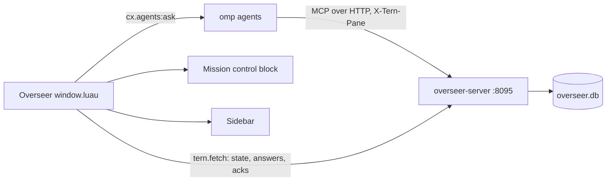

# Mission control: tasks and agents, built into Overseer

Date: 2026-11-14. Status: draft for review. Replaces the Huly setup (PERS-1)
and supersedes `2026-11-12-tasks-design.md`.

## Problem

Agents work across many repositories. You need one place, inside Tern, that
shows what needs you, what every agent is doing, and what's planned, and that
agents keep current themselves. Huly does this but is heavy (≈4.7 GB, 14
containers), mostly features you don't use, and needs workarounds: one shared
`omp` account, a formatting proxy, membership scripts, comment polling.

## Decisions

| Question | Decision |
|---|---|
| Where it lives | Inside Tern: a **Mission control** block, plus the sidebar |
| First view | **Needs you**: questions and decisions waiting on you, answered inline |
| Agent access | One shared MCP server over HTTP (`overseer-server`), custom tools |
| Storage | SQLite (`node:sqlite`, WAL), one file |
| Who runs the server | Overseer: starts it, restarts it when it dies |
| Agent identity | The pane, sent as a header; the server finds the omp session from it |
| Goals | Each runs in a Tern session of its own (coordinator and workers as tabs), apart from your sessions |
| Who starts a goal | You (Mission control, or an agent's proposal you accept); the coordinator then starts workers itself |
| Web app | None |

## 1. Architecture



- `server/` in this repo: TypeScript run by Bun (installed), using
  `@modelcontextprotocol/sdk` (streamable HTTP) and `bun:sqlite`. One process,
  bound to `127.0.0.1:8095`.
- Every request needs `Authorization: Bearer <token>`; the token is generated
  on first start into the plugin data directory (mode 600). omp reads it with
  a `!cat` header. Other local programs can't write tasks without it.
- Overseer starts the server with `tern.process.run` when the window starts,
  checks `GET /health` every tick, and restarts it after two failed checks
  (logged to `ops.log`).

## 2. Identity

omp's config for every session:

```json
"overseer": { "type": "http", "url": "http://127.0.0.1:8095/mcp",
  "headers": { "X-Tern-Pane": "${TERN_PANE}",
               "Authorization": "!printf 'Bearer %s' \"$(cat <data>/token)\"" } }
```

The server maps pane → omp session (`tern process` + the open session file,
else `--resume`/`--restore`, as `huly/bridge.cjs` does today), cached per pane.
Tasks belong to the session, so they survive Tern restarts. Repository and
branch come from the pane's working directory.

## 3. Data

| Table | Columns |
|---|---|
| `goals` | id (`G-3`), title, body (Markdown), coordinator (session), tern_session, status (`proposed` · `active` · `done` · `dropped`), created |
| `tasks` | id (`T-12`), goal (optional), title, body (Markdown), repo, branch, worktree, pr, status (`todo` · `ready` · `doing` · `done` · `failed` · `dropped`), session, started_by (session, for workers), created, updated |
| `deps` | task, needs (task): `task` becomes `ready` once every `needs` is `done` |
| `events` | id, task, author (`you` · a session id · `overseer`), kind (`note` · `question` · `answer` · `message` · `done` · `status`), body (Markdown), options (JSON, questions only), to_task (messages only), created, delivered |

- A task is **waiting** while it has a question with no answer after it.
- Agent state (working, idle, gone) is not stored: Overseer knows it live from
  Tern and joins it at display time.

## 4. MCP tools

Modelled on Orca's orchestration (runs, tasks, workers, inbox, `ask`,
`worker_done`), built for omp.

**Every agent**

| Tool | Does |
|---|---|
| `task_start` | Creates a task for the calling session, or takes `id` to pick one up (a worker's brief names it); status `doing` |
| `task_note` | A decision, a plan change, a PR (sets `pr`). Doubles as a heartbeat |
| `ask_user` | A question with numbered options and a recommended one; the task shows in Needs you. The only way to reach you: agents never message you any other way |
| `message` | To another task's agent (`T-12`), or `@goal` (every agent on the caller's goal), across repositories |
| `task_done` | Exactly once: `succeeded` (outcome, files changed) or `failed` (what's left). A worker's `done` also reaches its coordinator |
| `task_add` | A task for later, in any repository, optionally under a goal and depending on other tasks |
| `task_list` | By goal, repository, status, or `mine` |

**Coordinators** (the agent Overseer starts in a goal's session)

| Tool | Does |
|---|---|
| `goal_propose` | Any agent: proposes a goal (title, plan, tasks across repositories, dependencies). It shows in Needs you; Start makes it a goal with its own session and coordinator |
| `goal_plan` | Coordinator: adds, edits or drops its goal's tasks and dependencies |
| `worker_start` | Starts an omp agent on a `ready` task: Overseer creates a worktree for it (`wt switch --create`, branch named after the task) and opens omp there, as a background tab in the goal's session (`tern new tab`), with a brief naming the task |
| `inbox` | Waits (up to a timeout) for the goal's `done` events, questions and messages; returns them and marks them handled |
| `worker_stop` | Stops a worker; its task goes back to `ready` |

**Sensible launching** (enforced by the server, not left to the prompt):

- Writing tasks always get a new worktree, so parallel workers never share a checkout. Tasks marked `readonly` (research, review) may run in the repository's checkout.
- At most 4 workers per goal at once (setting), and workers can't start workers of their own.
- Only `ready` tasks can be started: dependencies done, no worker on it.
- Every start and stop is logged on the goal and shown in Mission control, with Stop.
- When a goal's last task finishes, its worktrees stay for review; Overseer's existing Delete removes them.

Descriptions carry the rules (when to ask, keep notes short, decisions go to
you), so a short `AGENTS.md` note replaces the `huly-tasks` skill.

## 5. Delivery to agents

- Your answers, and messages from other agents, are queued as events with
  `delivered` empty.
- Overseer fetches the queue each tick, sends each to its task's session pane
  with `cx.agents:ask`, then acks it (`POST /events/<id>/delivered`). A failed
  send stays queued.
- Agent-to-agent messages reach one agent at most once per 2 minutes, bundled.
  Yours go at once.
- `worker_start` is carried out by Overseer too: the server queues a start
  request, Overseer creates the worktree (Worktrunk, as New worktree does) and
  opens omp there as a tab in the goal's session (section 7), then reports the
  pane back.
- Coordinators wait with `inbox` instead of being prompted, so a finishing
  worker doesn't interrupt them mid-turn.

## 6. Mission control block

A plugin block (`palette › Mission control`, a key binding), full height in a
tab of its own. Three sections, top to bottom:

1. **Needs you**: each waiting task as a card: repo · task title, the question
   rendered as Markdown, options as buttons (recommended one marked), and a
   reply field. Answering records it and delivers it; the card leaves.
2. **Working**: tasks in `doing`, grouped under their goal (with its
   progress, e.g. 3 of 5 done) or under No goal; each row: live dot, repo,
   title, last note (one line), how long ago; a worker row has Stop. Enter or click goes to the agent's pane; `o`
   opens the task's thread.
3. **Todo**: collapsed count; expands to a list. `n` adds a task.

A task's **thread** (all its events, newest last, Markdown) opens beside the
block, with a reply field.

Sidebar, top to bottom:

- **Needs you N** (click opens Mission control).
- **Spaces**: your sessions only, as today. Goal sessions never appear here.
- **Goals** (new): one row per active goal: status dot (the most urgent of its
  agents), title, progress (`3/5`), a Needs you count when there is one. Click
  switches to the goal's session; the chevron unfolds its tasks, one row each
  (dot, `T-12 · title`, worker state), click goes to that worker's tab.
- **Agents**: agents in your sessions, as today (`idle · T-12 · title`).
  Goal agents show under their goal instead.

Keys: `↑↓` select, `↵` open/go, `1`–`9` pick an option, `r` reply, `n` new task,
`o` thread, `Esc` back.

## 7. Goal sessions

Your sessions are yours: Overseer never starts an agent in one. Everything a
goal runs lives in its goal's session.

- **Starting a goal** (Mission control › New goal, or Start on a proposal):
  Overseer creates a Tern session named `G-3 · <title>`, records it on the goal,
  and starts the coordinator in its first tab (`G-3 · coordinator`, in the
  repository you pick, or `~` for a goal across several) with a brief: the
  goal, its plan, and the coordinator tools.
- **Workers** open as tabs in that session, one per task (`T-12 · <title>`),
  each in its task's worktree.
- **Working alongside:** switch to the goal's session (sidebar › Goals) and
  type into any tab; your prompt goes to that agent like any other. To take a
  task over yourself, Open worktree on its row opens the worktree in a session
  of yours; the worker is stopped first.
- **Finishing:** when every task is done or dropped, the coordinator sends a
  summary as an `ask_user` (review, merge order, follow-ups). The session stays
  until you Close goal (sidebar menu), which closes the session and keeps the
  worktrees.
- **Restarts:** Tern restores the goal's session with its tabs; Overseer finds
  it again by the session id recorded on the goal, and agents by their omp
  sessions.

## 8. Migration and cutover

1. Build and run alongside Huly.
2. Import open Huly issues (title, description, comments) into tasks with a
   one-off script.
3. Switch `AGENTS.md` to the Overseer tools; remove the `huly` MCP entry.
4. Remove Huly as PERS-1 describes; delete `huly.luau`, `huly/`,
   `skills/huly-tasks/`.

## 9. Out of scope (v1)

Due dates, priorities, search, a web view, other people, workers on other
machines, agents other than omp as workers.

## Risks

- **The server is a new moving part.** Overseer's health check restarts it;
  SQLite keeps data safe across crashes.
- **`${TERN_PANE}` header expansion:** untested. Fallback: tools take an
  optional `session` argument, read by the agent from `$PI_SESSION_ID`.
- **Session lookup relies on omp keeping its session file open** (and
  `--resume`/`--restore` as fallback), as the Huly bridge does today.
- **Starting agents in the background** (checked 2026-11-14): `tern new
  session NAME --cwd DIR -- omp …` and `tern new tab SESSION --cwd DIR -- omp …`
  open in the background: the focused pane and shown session didn't change.
  omp started this way opens in Tern's native omp view (confirmed by the user),
  like the omp sessions in use today. Overseer starts goal sessions and
  workers this way, never with `cx.agents:start`, which opens beside the
  focused pane.
- **Focus** (checked 2026-11-14): omp started with a prompt in a new session
  ran its turn while the focused pane stayed the same for 20 s, polled every
  2 s. An earlier apparent focus pull was the user switching.
- **Rich input in a block:** Tern blocks support text fields and buttons
  (Overseer's forms use them); long replies are written in the thread's field.

## Verification

1. Server: start, health, token rejection, each tool through a real MCP client.
2. An omp agent started in Tern creates a task, asks a question; it appears in
   Needs you within a second; answering delivers it to that agent.
3. Tern restart: the task stays linked to its resumed session.
4. Two agents in different repositories exchange one `message`.
5. A goal started from Mission control opens its own session; your sessions
   gain no tabs; its workers appear under Goals in the sidebar.
6. A coordinator creates a goal across two repositories with one dependency,
   starts the ready task's worker in a new worktree, waits with `inbox`, and
   starts the dependent task once the first is done.

## Estimate

About 6 days: server and tools 1.5 days, delivery, identity and worker
starts 1, goal sessions 1, Mission control block and sidebar 1.5, migration
and cutover 0.5,
a real multi-repo goal as the end-to-end test 0.5.
