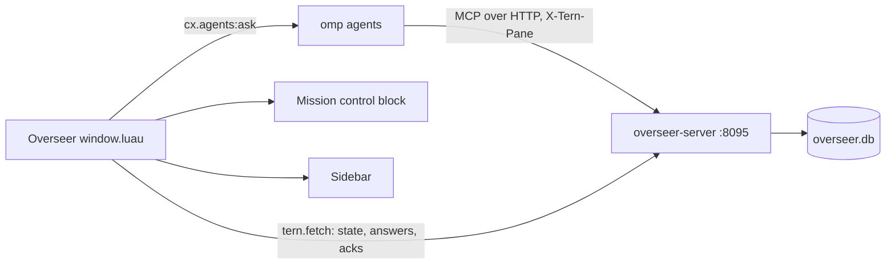

# Mission control: tasks and agents, built into Overseer

Date: 2026-11-14. Status: draft for review. Replaces the Huly setup (PERS-1)
and supersedes `2026-11-12-tasks-design.md`.

## Problem

Agents work across many repositories. You need one place, inside Tern, that
shows what needs you, what every agent is doing, and what's planned, and that
agents keep current themselves. Huly does this but is heavy (≈4.7 GB, 14
containers), mostly features you don't use, and needs workarounds: one shared
`omp` account, a formatting proxy, membership scripts, comment polling.

## Decisions

| Question | Decision |
|---|---|
| Where it lives | Inside Tern: a **Mission control** block, plus the sidebar |
| First view | **Needs you**: questions and decisions waiting on you, answered inline |
| Agent access | One shared MCP server over HTTP (`overseer-server`), custom tools |
| Storage | SQLite (`node:sqlite`, WAL), one file |
| Who runs the server | Overseer: starts it, restarts it when it dies |
| Agent identity | The pane, sent as a header; the server finds the omp session from it |
| Web app | None |

## 1. Architecture



- `server/` in this repo: TypeScript run by Bun (installed), using
  `@modelcontextprotocol/sdk` (streamable HTTP) and `bun:sqlite`. One process,
  bound to `127.0.0.1:8095`.
- Every request needs `Authorization: Bearer <token>`; the token is generated
  on first start into the plugin data directory (mode 600). omp reads it with
  a `!cat` header. Other local programs can't write tasks without it.
- Overseer starts the server with `tern.process.run` when the window starts,
  checks `GET /health` every tick, and restarts it after two failed checks
  (logged to `ops.log`).

## 2. Identity

omp's config for every session:

```json
"overseer": { "type": "http", "url": "http://127.0.0.1:8095/mcp",
  "headers": { "X-Tern-Pane": "${TERN_PANE}",
               "Authorization": "!printf 'Bearer %s' \"$(cat <data>/token)\"" } }
```

The server maps pane → omp session (`tern process` + the open session file,
else `--resume`/`--restore`, as `huly/bridge.cjs` does today), cached per pane.
Tasks belong to the session, so they survive Tern restarts. Repository and
branch come from the pane's working directory.

## 3. Data

| Table | Columns |
|---|---|
| `tasks` | id (`T-12`), title, body (Markdown), repo, branch, pr, status (`todo` · `doing` · `done` · `dropped`), session, created, updated |
| `events` | id, task, author (`you` · a session id · `overseer`), kind (`note` · `question` · `answer` · `message` · `status`), body (Markdown), options (JSON, questions only), to_task (messages only), created, delivered |

- A task is **waiting** while it has a question with no answer after it.
- Agent state (working, idle, gone) is not stored: Overseer knows it live from
  Tern and joins it at display time.

## 4. MCP tools (v1)

| Tool | Does |
|---|---|
| `task_start` | Creates a task for the calling session (or takes `id` to pick one up), status `doing` |
| `task_note` | Adds a note: a decision, a plan change, a PR (sets `pr`) |
| `ask_user` | Adds a question with optional numbered options and a recommended one; the task shows as waiting |
| `message_task` | Sends a message to another task's agent (any repository) |
| `task_done` | Status `done` with an outcome note; or `dropped` with what's left |
| `task_list` | Tasks by repo, status or session; `mine` for the caller's |
| `task_add` | Adds a `todo` task for later (a follow-up), any repository |

Descriptions carry the rules (when to ask, keep notes short, decisions go to
the user), so a short `AGENTS.md` note replaces the `huly-tasks` skill.

## 5. Delivery to agents

- Your answers, and messages from other agents, are queued as events with
  `delivered` empty.
- Overseer fetches the queue each tick, sends each to its task's session pane
  with `cx.agents:ask`, then acks it (`POST /events/<id>/delivered`). A failed
  send stays queued.
- Agent-to-agent messages reach one agent at most once per 2 minutes, bundled.
  Yours go at once.

## 6. Mission control block

A plugin block (`palette › Mission control`, a key binding), full height in a
tab of its own. Three sections, top to bottom:

1. **Needs you**: each waiting task as a card: repo · task title, the question
   rendered as Markdown, options as buttons (recommended one marked), and a
   reply field. Answering records it and delivers it; the card leaves.
2. **Working**: one row per task in `doing`: live dot, repo, title, last note
   (one line), how long ago. Enter or click goes to the agent's pane; `o`
   opens the task's thread.
3. **Todo**: collapsed count; expands to a list. `n` adds a task.

A task's **thread** (all its events, newest last, Markdown) opens beside the
block, with a reply field.

Sidebar: a **Needs you N** line at the top (click opens Mission control),
and agent rows show their task (`idle · T-12 · title`), as today.

Keys: `↑↓` select, `↵` open/go, `1`–`9` pick an option, `r` reply, `n` new task,
`o` thread, `Esc` back.

## 7. Migration and cutover

1. Build and run alongside Huly.
2. Import open Huly issues (title, description, comments) into tasks with a
   one-off script.
3. Switch `AGENTS.md` to the Overseer tools; remove the `huly` MCP entry.
4. Remove Huly as PERS-1 describes; delete `huly.luau`, `huly/`,
   `skills/huly-tasks/`.

## 8. Out of scope (v1)

Goals and multi-repo plans with dispatching agents (v2, builds on
`message_task` and `task_add`), due dates, priorities, search, a web view,
other people.

## Risks

- **The server is a new moving part.** Overseer's health check restarts it;
  SQLite keeps data safe across crashes.
- **`${TERN_PANE}` header expansion:** untested. Fallback: tools take an
  optional `session` argument, read by the agent from `$PI_SESSION_ID`.
- **Session lookup relies on omp keeping its session file open** (and
  `--resume`/`--restore` as fallback), as the Huly bridge does today.
- **Rich input in a block:** Tern blocks support text fields and buttons
  (Overseer's forms use them); long replies are written in the thread's field.

## Verification

1. Server: start, health, token rejection, each tool through a real MCP client.
2. An omp agent started in Tern creates a task, asks a question; it appears in
   Needs you within a second; answering delivers it to that agent.
3. Tern restart: the task stays linked to its resumed session.
4. Two agents in different repositories exchange one `message_task`.

## Estimate

About 3–4 days: server and tools 1 day, delivery and identity 0.5, Mission
control block and sidebar 1.5, migration and cutover 0.5.
