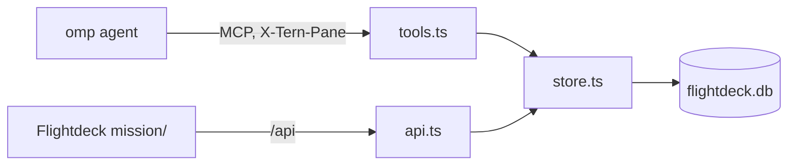

# flightdeck-server

Mission control's server: tasks, goals, questions, messages and workers for omp agents, in one SQLite file. Flightdeck starts it (`mission/server.luau`) and talks to it over HTTP; agents use it as an MCP server.

```sh
bun install
bun test                      # every rule and endpoint
bun src/main.ts <data dir>    # what Flightdeck runs; port 8095 (FLIGHTDECK_PORT)
```

## Modules

| File | Responsibility |
|---|---|
| `src/store.ts` | Schema and every read, write and rule: task statuses, dependencies (`promote`), goals and their coordinator, questions (`waiting`), messages, worker limits, the coordinator inbox, deliveries with the 2-minute agent-message gap. No I/O besides SQLite. Change behaviour here. |
| `src/tools.ts` | The MCP tools agents see. Each resolves its caller, calls `store`, and turns a broken rule into a tool error. Tool descriptions are the agents' instructions. |
| `src/api.ts` | Flightdeck's JSON API (`/api/*`): state, the backlog (every goal and task), repositories (list, ignore), threads, answers, goal start/session/close, deliveries, worker starts and stops, pane → session lookup. Also the coordinator and worker briefs. |
| `src/identity.ts` | Which omp session a request comes from: `X-Tern-Pane` → `tern process` → the session file the pane's process group holds open (or `--resume`/`--restore`), plus its folder, repository and branch. |
| `src/extensions.ts` | Panels other tools publish (`POST /api/extensions/<id>`), validated with zod, kept in the `extensions` table, shown as sidebar sections and Mission control tabs; call-back buttons POST to the extension's loopback `callback`. See Extensions below. |
| `src/repos.ts` | `repoInfo`: a repository's worktrees from `wt list --format=json` (Repos details, `GET /api/repos/<name>/info`). Finds Git repositories (breadth-first from `repos.json` roots, default `~`, depth 5, skipping system and build folders; worktrees and nested repositories don't count). `main.ts` scans at start, every 30 minutes and on `POST /api/repos/scan`; `store.syncScanned` records it. |
| `src/github.ts` | GitHub through `gh`: open issues of known repositories (remote → owner/name), comments on linked issues, closing one you chose. Never closes issues on its own. |
| `src/analytics.ts` | The Stats tab: reads new usage (cost, tokens) from omp's session files every 5 minutes by byte offset into `usage`; agent counts the window posts each minute (`agent_samples`, kept 30 days); `analytics()` builds spend, agent and goal/task series for `GET /api/analytics`. |
| `src/events.ts` | `GET /api/events`: a stream of the change counter, a line after every agent tool call or API POST (and a heartbeat every 20 s), so clients fetch on change instead of polling. |
| `src/main.ts` | `Bun.serve` on 127.0.0.1: `/health` (open), `/mcp` and `/api/*` (bearer token from `<data dir>/token`, created on first start). |

## Data flow



Answers and agents' messages are queued as events; Flightdeck fetches `/api/deliveries`, sends each to the pane running its session, then acks it. Worker starts are queued the same way (`/api/workers`), and Flightdeck opens them. Goal lifecycle: proposed → active (started) → done (the coordinator's `goal_complete`, which checks tasks, workers, questions and worktrees; or the user's Close goal) or dropped. `finished` is a legacy state from before `goal_complete`. Coordinators manage workers: `worker_stop` closes one (a finished task stays finished), `worker_start` on a done or failed task reopens it, switching to its existing branch, with optional `context` added to the brief.

## Conventions

- Ids are integers in SQLite. People and agents see references: goals `G3` (`Store.gid`, `parseGoal`), a goal's tasks `G3.2` numbered within it by `tasks.seq` (the coordinator's own task is `G3.0`), tasks outside goals `T7` (`seq` from the `loose` counter), workers `W5`. `store.tref(id)` and `store.taskId(ref)` convert; goal ids and the `loose` counter only grow (`counters` table), so a number never comes back after the 30-day cleanup. The first release's `T-12` (internal id) and `G-3` are still accepted. Message targets (`events.to_target`) keep the internal `T-<id>` form.
- Rule errors are thrown as `Error` with a message an agent can act on; `tools.ts` and `api.ts` return them, never crash.
- Tests use an in-memory store and an injected clock (`new Store(":memory:", () => clock)`).

## Demo scenarios

`bun scripts/demo.ts` creates three small repositories in `~/projects/flightdeck-demo` (`demo-payments`, `demo-storefront`, `demo-design-system`) and proposes four goals across them, plus one task for later:

- **Add Apple Pay to checkout**: three tasks in three repos; the storefront task waits for the other two.
- **Dark mode**: two tasks; the first asks you which brand colour to use.
- **Rate-limit login**: one task that asks you how to limit.
- **Order history**: no tasks; its coordinator reads the repos and plans them.

Start one from Mission control. `bun scripts/demo.ts --reset` drops the demo goals and tasks and deletes the repos and their worktrees (`~/worktrees/demo-*`); close any started goal's session with **Close goal** first.

## Idle coordinators

A coordinator that ended its turn stops calling `inbox`, so workers' results would sit unread. After `COORDINATOR_WAKE_MS` (2 minutes) unread, inbox items go to its pane like any delivery (only while it isn't mid-turn) and count as read.

## Extensions

Other tools on this Mac (a private Tern plugin, a script, a local service) can add a section to the sidebar and a tab to Mission control, without Flightdeck knowing what they are (`src/extensions.ts`).

1. Read the token from `~/Library/Application Support/Tern/plugin-data/flightdeck/token`.
2. `POST /api/extensions/<id>` with `Authorization: Bearer <token>` and the whole panel, whenever it changes and at least every few minutes. Mission control says when a panel is more than 10 minutes old; one silent for a day is dropped.
3. Buttons either open a link (`url`) or are POSTed to your `callback` (127.0.0.1 or localhost only) as `{ "item", "action", "text"? }`. Answer `{ "ok": true, "message": "Shown to the user" }`, then publish the panel again with what changed.
4. `POST /api/extensions/<id>/remove` takes it away.

```json
{
  "title": "Acme CI",
  "url": "https://ci.example",
  "callback": "http://127.0.0.1:8123/action",
  "sections": [{
    "title": "Active workstreams",
    "sidebar": true,
    "items": [{
      "id": "ws-12",
      "title": "Routing trial",
      "subtitle": "Manager: checking routes.toml",
      "status": { "label": "Needs you", "tone": "waiting" },
      "repo": "web-app",
      "url": "https://ci.example/runs/12",
      "body": "Markdown shown in its details.",
      "facts": [["Owner", "Jack"]],
      "actions": [
        { "id": "complete", "label": "Complete it", "primary": true, "confirm": "Deletes its workspace." },
        { "id": "answer", "label": "Answer", "input": "Your answer" }
      ]
    }]
  }]
}
```

`tone` is one of `working`, `waiting`, `done`, `failed`, `idle`. `id`: lowercase letters, digits and dashes. Item ids: letters, digits and `. _ : -`. Items with a `repo` follow Mission control's repo filter. `confirm` asks first; `input` asks for text first.

